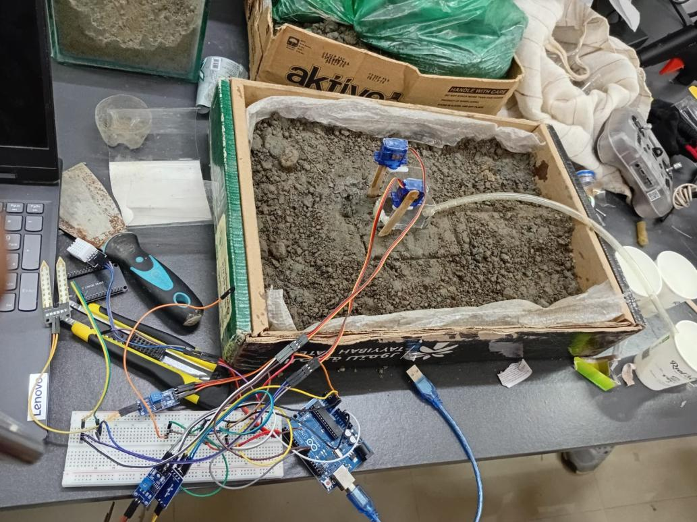
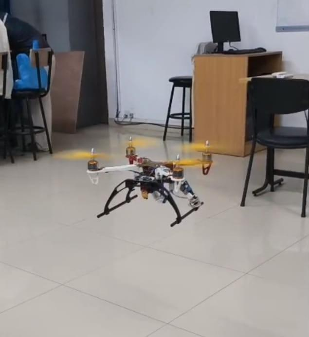
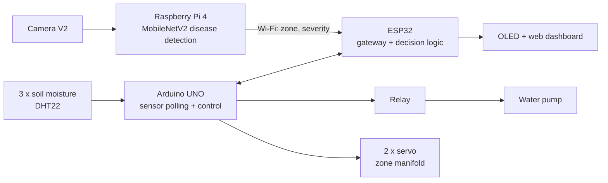
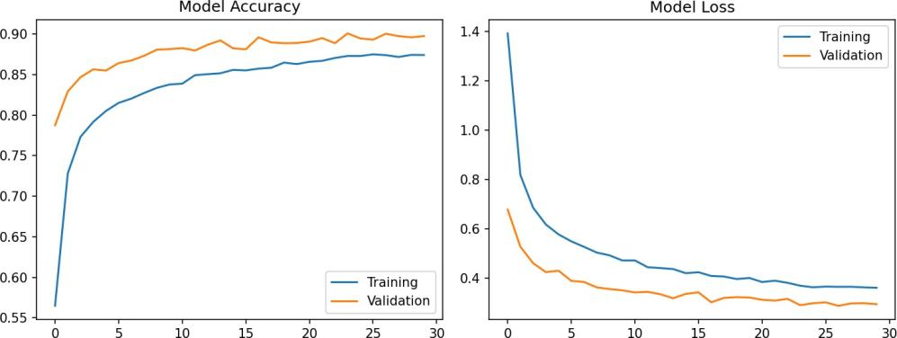
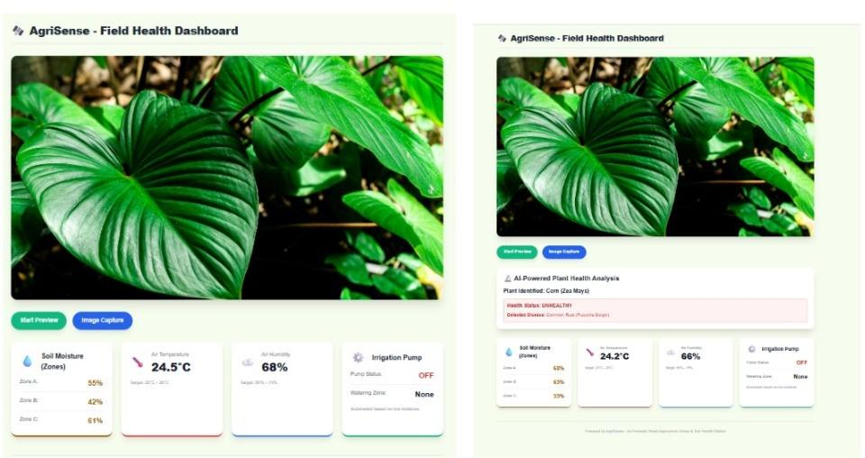

<h1 align="center">AgriSense</h1>
<h3 align="center">AI-Powered Smart Agriculture Drone &amp; Soil Health Station</h3>

<p align="center">
  A two-tier precision-agriculture prototype: a <b>quadcopter</b> that spots plant disease with deep learning,
  and a <b>ground station</b> that measures the soil and waters <b>only the zones that need it</b>.
</p>

<p align="center">
  
  
  
  
  
  
</p>

<table align="center">
  <tr>
    <td align="center"><br><sub>The Quadcopter (UAV Tier)</sub></td>
    <td align="center"><br><sub>Ground Station with Soil Sensors</sub></td>
    <td align="center"><br><sub>Flying-Test of the Quadcopter</sub></td>
  </tr>
</table>

---

## Table of Contents

1. [About the project](#about-the-project)
2. [How it works](#how-it-works)
3. [What is in this repository](#what-is-in-this-repository)
4. [Hardware](#hardware)
5. [Ground-station firmware](#ground-station-firmware)
6. [AI plant-disease detection](#ai-plant-disease-detection)
7. [Web dashboard](#web-dashboard)
8. [Project structure](#project-structure)
9. [Getting started](#getting-started)
10. [Project timeline](#project-timeline)
11. [Limitations and future work](#limitations-and-future-work)
12. [Documentation](#documentation)
13. [Team](#team)

---

## About the project

Farming still applies water, fertiliser and pesticide **uniformly**, regardless of what each area needs, and crop problems
are often noticed only when the damage is visible. AgriSense combines **aerial imaging** with **on-ground sensing** so
resources follow evidence instead of fixed schedules:

- the **drone** surveys the field and uses a computer-vision model to find stressed or diseased plants,
- the **ground station** tracks soil moisture, air temperature and humidity and controls irrigation,
- together they form a loop: *the drone sees the big picture, the ground station handles the fine details.*

Built by **Team Micro Maniacs (Group 1)** at the Department of Computer Science and Engineering,
**United International University (UIU)**, in five weeks.

## How it works



The decision rule from the report: **IF** soil moisture &lt; threshold **AND** the UAV reports stress in that zone
**THEN** water that zone.

## What is in this repository

The report describes the whole system. The table shows which parts are committed as code.

| Component | Status |
|---|---|
| Ground-station firmware (sensing, thresholds, pump, 3-zone servo routing) | **In this repo** - [`firmware/`](firmware/GroundStation) |
| Camera capture script (Picamera2) | **In this repo** - [`raspberry-pi/capture.py`](raspberry-pi/capture.py) |
| Disease detection script (Rembg + MobileNetV2) | **In this repo** - [`raspberry-pi/detection.py`](raspberry-pi/detection.py) |
| Trained model `plant_disease_model.h5` + `class_indices.json` | Described in the report - not included |
| Model training notebook | Described in the report - not included |
| ESP32 gateway / decision logic and OLED code | Described in the report - not included |
| Drone-to-ground Wi-Fi report and GPS mapping | Described in the report - not included |
| Web dashboard | Shown in the report - not included |
| Two-way telemetry, backup power | Future work |

> In the committed code the **Arduino UNO** makes the irrigation decision from soil moisture alone, and the Raspberry Pi
> uses a neural-network classifier. The ESP32 fusion logic described in the report is not part of this repository yet.

## Hardware

| Ground station | Drone (UAV) |
|---|---|
| Arduino UNO, ESP32 (WROOM32) | Raspberry Pi 4 (4 GB), Camera V2 |
| 3 x soil-moisture probes, DHT22 | F405 V3 PLUS flight controller, 4 x ESC |
| 4-channel relay, mini DC pump | 4 x DJI 2212 920KV motors, F450 frame |
| 2 x SG90 servos (zone manifold) | MATEK XT60 PDB, 3S 3500 mAh LiPo |
| OLED I2C 0.96", 12 V 2 A adapter | propellers, silicone wire, battery straps |

Total cost is about **35,000 BDT** (the report states 35,070 BDT). Full list, prices, pin map and safety notes:
[`hardware/`](hardware/README.md).

## Ground-station firmware

[`firmware/GroundStation/GroundStation.ino`](firmware/GroundStation/GroundStation.ino) reads three soil probes and the DHT22
every 2 seconds, converts moisture to a percentage and switches the pump and servos.

| Setting | Value |
|---|---|
| Calibration | raw 800 = 0 % (dry), raw 300 = 100 % (wet) |
| Irrigation threshold | a zone needs water below **30 %** |
| Pump | relay on D4, **active-LOW** |
| Servos | D9 (zone 1), D10 (zone 2); angles chosen per combination of dry zones |
| Serial monitor | 9600 baud |

Three zones are served with **one pump and two servos**: the code writes a different pair of angles for each combination
of dry zones (zone 3 is the main line). The full routing table is in the
[documentation](docs/AgriSense_Complete_Project_Documentation.pdf), section 7.3.

## AI plant-disease detection

| Item | Value (from the report) |
|---|---|
| Dataset | [PlantVillage](https://www.kaggle.com/datasets/abdallahalidev/plantvillage-dataset) - subset of **20,639 images**, **15 classes** (pepper, potato, tomato) |
| Preprocessing | background removal with [Rembg](https://github.com/danielgatis/rembg), plain white background, 224 x 224, pixels / 255 |
| Model | MobileNetV2, transfer learning / fine-tuning, about 2.5 M parameters, 23.7 MB |
| Validation accuracy | **92.09 %** (reported) |



> The text reports 92.09 % while the plotted validation curve levels off near 0.90. Re-run an evaluation on a held-out test
> set to quote a final number. Training used laboratory photos, so accuracy on real drone images will be lower.

`raspberry-pi/capture.py` takes a 1920 x 1080 photo on a keypress; `raspberry-pi/detection.py` removes the background,
resizes the image and prints the predicted disease with a confidence score.

## Web dashboard

The report shows an *AgriSense Field Health Dashboard* with three-zone soil moisture, temperature, humidity, pump status,
a camera preview with capture, and an **AI-powered plant-health analysis** panel. The dashboard code is not part of this
repository yet.



## Project structure

```text
AgriSense-Smart-Agriculture-Drone-and-Soil-Station/
├── firmware/GroundStation/GroundStation.ino   # Arduino ground-station sketch
├── raspberry-pi/
│   ├── capture.py                             # camera capture (Picamera2)
│   └── detection.py                           # Rembg + MobileNetV2 prediction
├── hardware/
│   ├── bill_of_materials.csv                  # components, quantities, prices (BDT)
│   └── README.md                              # pin map, cost check, safety
├── docs/
│   ├── AgriSense_Complete_Project_Documentation.pdf
│   ├── Final_Project_Report.pdf
│   ├── images/                                # figures used in this README
│   └── archive/                               # earlier draft of the report
├── requirements.txt                           # Python packages for detection.py
└── README.md
```

## Getting started

### Ground station (Arduino)

1. Install the [Arduino IDE](https://www.arduino.cc/en/software) and, from *Library Manager*, **DHT sensor library** and **Adafruit Unified Sensor**.
2. Open `firmware/GroundStation/GroundStation.ino`, choose **Arduino Uno** and your port.
3. Wire the pins from [`hardware/README.md`](hardware/README.md), upload, and open the Serial Monitor at **9600 baud**.
4. Calibrate `DRY_VALUE` and `WET_VALUE` for your own probes and soil.

### Vision scripts (Raspberry Pi / PC)

```bash
git clone https://github.com/Rahil03-git/AgriSense-Smart-Agriculture-Drone-and-Soil-Station.git
cd AgriSense-Smart-Agriculture-Drone-and-Soil-Station
pip install -r requirements.txt

# capture a photo on the Raspberry Pi (press Enter to take it)
python3 raspberry-pi/capture.py
```

To run `detection.py`, copy your trained **`plant_disease_model.h5`** and **`class_indices.json`** into the
`raspberry-pi/` folder, set `example_image_path` inside the script, then:

```bash
cd raspberry-pi
python3 detection.py
```

## Project timeline

| Week | Focus | Outcome |
|---|---|---|
| 1 | Planning and procurement | Concept defined, components procured |
| 2 | Ground station | Sensors, relay and pump connected; irrigation triggered by firmware |
| 3 | Core flight system | F450 quadcopter built and tuned; first controlled flight passed |
| 4 | Intelligence and vision | Raspberry Pi and camera mounted; model trained |
| 5 | Integration | Flight hardware and AI merged; full-scale tests and demonstration |

## Limitations and future work

- [ ] Add the trained model, class list and training notebook so detection can be reproduced
- [ ] Add the ESP32 gateway / OLED code and the web dashboard
- [ ] Irrigation: add hysteresis, a maximum pump run-time, and use the DHT22 data
- [ ] Two-way telemetry (433 / 900 MHz) and a mission-control hub
- [ ] Backup power and low-voltage alert for the drone
- [ ] Field-collected images, more crops and classes, test-set evaluation
- [ ] Field trials measuring water saving, early-detection time and yield

## Documentation

A complete project document - architecture, hardware and cost, firmware analysis, AI model, test plan, safety notes and a
viva guide - is in [`docs/AgriSense_Complete_Project_Documentation.pdf`](docs/AgriSense_Complete_Project_Documentation.pdf).
The original report is in [`docs/Final_Project_Report.pdf`](docs/Final_Project_Report.pdf).

## Team

**Team Micro Maniacs (Group 1)** - Department of Computer Science and Engineering, United International University (UIU), Dhaka.

| Name | Role |
|---|---|
| **Kazi Shibli Zaman Rahil** - [@Rahil03-git](https://github.com/Rahil03-git) | **Project owner and main developer** |
| Hasan Al Banna | Team member |
| Syed Rafid | Team member |
| Sumaita Binte Hafiz | Team member |
| Nazifa Tabassum | Team member |

<!-- Add GitHub links or specific roles, for example:
| Name - [@github-username](https://github.com/github-username) | firmware / AI model / drone |
-->

**Acknowledgements:** the [PlantVillage](https://www.kaggle.com/datasets/abdallahalidev/plantvillage-dataset) dataset and the
[Rembg](https://github.com/danielgatis/rembg) background-removal tool. Please check the dataset page for its licence terms.

---

<p align="center">Built with Arduino, Raspberry Pi and TensorFlow.</p>
